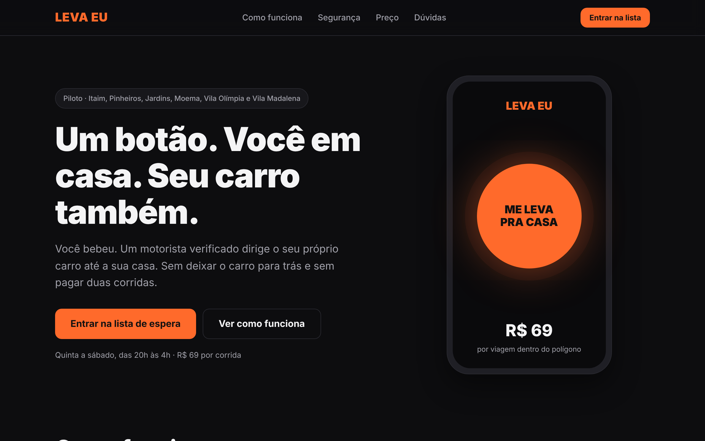
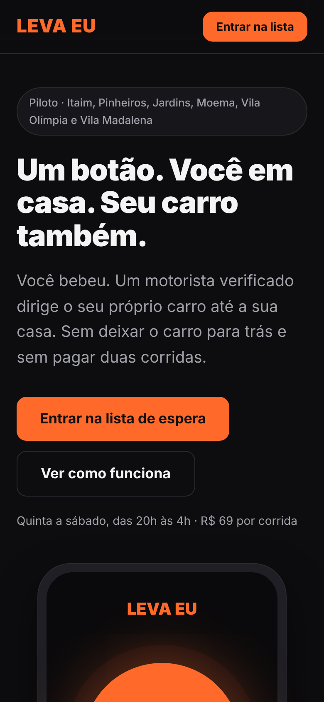

<div align="center">

# LEVA EU

**Um botão leva você e o seu carro para casa.**

Motorista sob demanda que dirige o *seu próprio carro* até a sua casa depois que você bebeu.




</div>

---

## Sumário

- [O problema](#o-problema)
- [A solução](#a-solução)
- [O que este repositório entrega](#o-que-este-repositório-entrega)
- [Como funciona a página](#como-funciona-a-página)
- [Rodar localmente](#rodar-localmente)
- [Configurar](#configurar-configjs)
- [Publicar no GitHub Pages](#publicar-no-github-pages)
- [Teste A/B/C de posicionamento](#teste-abc-de-posicionamento)
- [Como medir o smoke test](#como-medir-o-smoke-test)
- [Estrutura de pastas](#estrutura-de-pastas)
- [Privacidade e LGPD](#privacidade-e-lgpd)
- [Status das hipóteses](#status-das-hipóteses)
- [Roadmap](#roadmap)
- [Equipe](#equipe)

## O problema

Quem vai de carro para beber não consegue voltar sem abandonar o carro. Sobram três saídas ruins:

| Saída | Custo |
|---|---|
| Dirigir mesmo assim ("é perto, não vai dar em nada") | Multa, suspensão da CNH, risco criminal e risco de vida |
| Deixar o carro e voltar de aplicativo | Duas corridas, diária de estacionamento, risco de furto e a manhã seguinte perdida |
| Pedir a um amigo que não bebeu | Sem escala, sem verificação, sem seguro |

A decisão acontece no pior momento: tarde da noite, com o julgamento comprometido.

## A solução

Na hora de ir embora, a pessoa aperta um botão. Um motorista verificado chega, **dirige o carro dela** e leva as duas até a garagem.

- Tudo que exige decisão (endereço, carro, pagamento) acontece no cadastro, com a pessoa sóbria.
- Tarifa única de **R$ 69** por corrida (valor previsto para o piloto).
- Operação no polígono **Itaim · Pinheiros · Jardins · Moema · Vila Olímpia · Vila Madalena**, de quinta a sábado, das 20h às 4h.

O modelo é consolidado na Coreia do Sul (*daeri unjeon*) e na China (*daijia*). No Brasil, hoje só existe informalidade.

## O que este repositório entrega

Este é o **MVP 0** da Sprint 2: uma landing page que funciona como *smoke test* de demanda e porta de entrada do piloto concierge.

| Entrega | Onde |
|---|---|
| Página pública com CTA de lista de espera | `index.html` |
| Cadastro com validação e envio por Google Forms ou WhatsApp | `js/app.js` |
| Teste A/B/C das 3 frases de posicionamento (CP2) | `js/app.js` |
| Contagem de visitantes e conversões (GA4, opcional) | `js/app.js` + `config.js` |

<div align="center">

</div>

## Como funciona a página

1. O visitante cai na página e vê uma das 3 frases de posicionamento.
2. Lê como funciona, o preço e as dúvidas.
3. Preenche nome, WhatsApp, bairro e carro e aceita o uso dos dados.
4. O cadastro vai para a planilha (Google Forms) ou abre o WhatsApp com a mensagem pronta.
5. O time entra em contato e opera a corrida na mão (**MVP concierge**).

Não há pagamento, despacho automático, app nem login nesta fase. Tudo isso é manual de propósito: faça o que não escala, automatize só o que provou valor.

## Rodar localmente

Não precisa instalar nada. É HTML, CSS e JavaScript puros.

```bash
git clone https://github.com/Kaiomeireles/sprint2.git
cd sprint2

# abra o index.html no navegador, ou sirva a pasta:
python3 -m http.server 8000
# http://localhost:8000
```

## Configurar (`config.js`)

| Campo | Para quê | Obrigatório |
|---|---|---|
| `whatsapp` | Número que recebe os pedidos. DDI + DDD + número, só dígitos. Ex.: `5511999999999` | Sim, se não houver Forms |
| `formAction` | URL do Google Forms terminada em `/formResponse` | Não |
| `entries` | IDs dos campos do Forms (`entry.123…`) para nome, whatsapp, bairro, carro, variante e origem | Se usar Forms |
| `ga4` | ID do Google Analytics 4. Ex.: `G-XXXXXXXXXX` | Não |

Sem `whatsapp` e sem `formAction`, o formulário avisa que o cadastro não está disponível, em vez de fingir que enviou.

## Publicar no GitHub Pages

1. No GitHub, abra **Settings → Pages**.
2. Em **Source**, escolha a branch `main` e a pasta `/ (root)`.
3. O link público será `https://kaiomeireles.github.io/sprint2/`.

## Teste A/B/C de posicionamento

A página sorteia uma das três frases e lembra a escolha do visitante (`localStorage`).

| Variante | Frase | Ângulo |
|---|---|---|
| **A** | Você bebeu. Não dirija. E não deixe seu carro para trás. | Segurança e evitação de perda |
| **B** | Duas corridas e uma diária de estacionamento. Ou R$ 69. | Racional e comparativo |
| **C** | Um botão. Você em casa. Seu carro também. | Simplicidade e conveniência |

- Forçar uma variante: `?v=A`, `?v=B` ou `?v=C`.
- Marcar o canal de tráfego: `?utm_source=instagram&utm_medium=bio&utm_campaign=piloto`.
- Métrica de decisão: taxa de cadastro na lista de espera por variante.

## Como medir o smoke test

Eventos enviados ao GA4, sempre com os parâmetros `variante` e `origem`:

| Evento | Quando dispara |
|---|---|
| `cta_topo` | Clique no botão do topo |
| `cta_hero` | Clique no botão principal |
| `cta_whatsapp` | Clique em "Prefiro falar no WhatsApp" |
| `cadastro_lista` | Cadastro concluído |

**Conta para os slides:** visitantes = usuários do GA4 no período · conversões = linhas na planilha (ou conversas no WhatsApp) · taxa = conversões ÷ visitantes.

## Estrutura de pastas

```text
sprint2/
├── index.html        # conteúdo da página
├── config.js         # suas configurações (WhatsApp, Forms, GA4)
├── css/
│   └── style.css     # visual, no estilo do protótipo do Figma
├── js/
│   └── app.js        # formulário, teste A/B/C, analytics e animações
└── docs/             # imagens deste README
```

## Privacidade e LGPD

- Coletamos só **nome, WhatsApp, bairro e carro**, para falar com a pessoa sobre o piloto.
- O aceite de uso dos dados é obrigatório para enviar o cadastro.
- A pessoa pode pedir a exclusão a qualquer momento.
- A planilha de cadastros deve ficar privada, com acesso só aos sócios e verificação em duas etapas.

## Status das hipóteses

Tudo aqui é hipótese até alguém de fora confirmar.

| # | Hipótese | Status |
|---|---|---|
| H1 | Existe seguradora que emita apólice de responsabilidade civil na margem | Não testada |
| H2 | Ao menos 30% pagariam R$ 69 | Confirmada no declarado em 5 entrevistas, com sensibilidade a preço. Falta medir comportamento real |
| H3 | Existem motoristas com CNH e sem carro por cerca de R$ 47/h | Não testada |
| H4 | O reposicionamento do motorista custa até R$ 12 no polígono | Não testada |
| H5 | O motorista chega em até 15 minutos | Não testada |

## Roadmap

- [x] CP1: descoberta, Lean Canvas e hipóteses
- [x] CP2: proposta de valor, posicionamentos e definição do protótipo
- [x] Protótipo navegável no Figma
- [x] MVP 0: landing page com lista de espera
- [ ] Medir o smoke test e escolher a variante vencedora
- [ ] MVP concierge: primeira corrida real com cliente de fora do grupo
- [ ] Validar o seguro de responsabilidade civil (H1)
- [ ] Automatizar o despacho
- [ ] App com pagamento (2º período)

## Equipe

Projeto da turma **4ESPR** · Business Intelligence & Startup Development.

| Nome | Papel |
|---|---|
| Guilherme Fernandes de Freitas | Produto e Pesquisa |
| Henrique Rafael Gomes de Souza | Tecnologia |
| João Pedro Chizzolini de Freitas | Design e Protótipo |
| Kaio Vinicius Meireles Alves | Negócio e Operação |
| Lucas Alves de Souza | Dados e Métricas |

<div align="center">

<sub>Projeto acadêmico em fase de teste. Ainda não há corridas abertas ao público.</sub>

</div>
